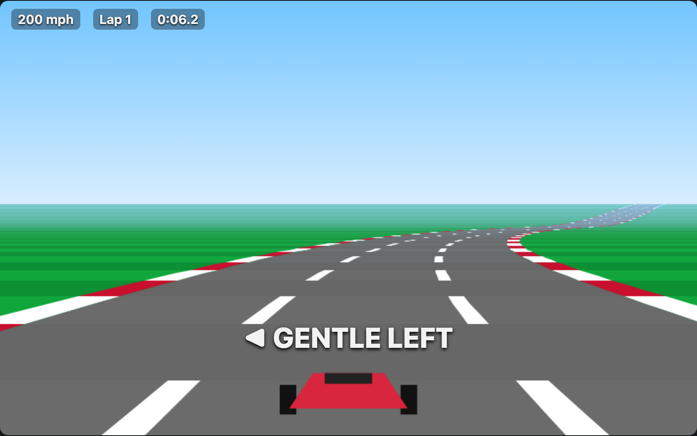

# Drive: a game that adapts to the player, and how to write your own surface for the AI for Accessibility Toolkit

A first-person driving game in the Pole Position tradition: a looping track
with curves and a hill, steer, accelerate, brake, lap times. You can play it
by sight, **by ear** (a tone tells you where the road is, ticks warn of
curves, a voice tells you what happened), or **by voice** ("go", "left",
"brake"). Tell it what you need in your own words — "I can't see the
screen", "I get motion sick", "I only have one hand", "I'm deaf" — and it
adapts, and remembers.

It is the second tutorial for the
[AI for Accessibility Toolkit](https://github.com/AI-for-Accessibility-Collective/AI-for-Accessibility-Toolkit).
The first, the [reader demo](https://github.com/AI-for-Accessibility-Collective/ai4a11y-reader-demo),
shows the standard loop: needs → web settings → catalog adapters. A game
can't use most of the catalog (it fixes DOM pages), so this one shows the
thing the toolkit was designed for and the reader didn't need: **writing
your own surface**.

> The toolkit is a pre-alpha research project. Nothing here replaces
> assistive technology, and the game is a demonstration, not a product.



## Run it

Node 20.12+ and a Gemini API key ([aistudio.google.com/apikey](https://aistudio.google.com/apikey)).

```bash
npm install
cp .env.example .env     # put GEMINI_API_KEY=... in it
npm start                # open http://127.0.0.1:5174/
```

## How to play

The track is a loop: a start straight, a gentle left, a hill, a medium right
over the crest, a long back straight, a sharp left-right chicane, a long
gentle left, and the home straight. One lap takes about 25 seconds flat out
and a minute or so if you're careful. Curves push the car outward; the grass
slows you hard. Beat your best lap.

**With the keyboard**

| Key | Does |
|---|---|
| ↑ or Space | accelerate (also starts the race) |
| ← → | steer |
| ↓ | brake |
| P | pause / resume |
| R | restart from the start line |
| W | say where you are |
| Ctrl+Space | voice on / off |

**With your voice** — click 🎤 Voice once; it keeps listening. Driving words
act in about 200 ms and never go to a model:

| Say | Does |
|---|---|
| "go" | start, and keep the accelerator down |
| "left", "right" — "hard left", "hard right" | a nudge, or a bigger one |
| "straight" | stop steering |
| "faster", "slower" | accelerator down / off |
| "brake", "stop" | brake |
| "pause" | pause |
| "where am I", "how fast" | the game tells you |
| "restart", "help" | as they say |

**Telling it what you need** — type or say a sentence; the model turns it
into needs and the game adapts (and remembers across reloads):

| Say | What happens |
|---|---|
| "I can't see the screen" | sounds guide you: a tone where the road's middle is (steer toward it), ticks on the side a curve is coming, a voice for curves, grass and laps; the car steers itself a little |
| "I get motion sick" | no camera shake, no horizon bob, the view leans less into curves |
| "I only have one hand" | single-switch: any key accelerates, the car steers itself |
| "I'm deaf" | every sound becomes an arrow or a line of text on screen |
| "make the game easier" | slower top speed, wider road, earlier warnings, fewer numbers |
| "bigger numbers", "high contrast", "less assist", "turn off the commentary" | one setting at a time |
| "what do the sounds mean?" | it explains |
| "forget everything and start over" | profile cleared |

**Playing by ear** — after "I can't see the screen": say "go". A low engine
note rises with your speed. When you drift, a tone appears on the side the
road's middle is; steer toward it until it goes quiet. It turns harsh when
you're on the grass. Ticks on one side mean a curve is coming on that side;
they speed up as it nears, and a voice says "sharp left ahead". The car
helps you steer at first; say "less assist" when you've learned the sounds.

## How it is built

[`public/app.js`](public/app.js) is the host, written top to bottom in the
order a host uses the toolkit. The game ([`game.js`](public/game.js)) knows
nothing about accessibility: it exposes a `settings` object, an `input`
object, and events. Everything adaptive is in the host and its surface.

### Step 1: the toolkit over your ports

Same as the reader: `createToolkit` with one port you write (storage over
`localStorage`, [`ports/local-storage-kv.js`](public/ports/local-storage-kv.js))
and the toolkit's reference clock and scheduler.

### Step 2: needs, through the Librarian

Same as the reader: `librarian.setProfileField('fields.needs', [...])`,
merged per dimension, a stack for undo. The dimensions are the interesting
part here:

- **Standard ones**, meaning here what they mean everywhere: `reduceMotion`,
  `contrast`, `textSize`, `captions`, `readAloud`, `readAloudRate`, `simplify`.
  A profile that says `reduceMotion` from any other app steadies this game.
- **Three of the game's own**: `audioNavigation`, `steeringAssist`, `pace`,
  `singleSwitch`. A surface may define dimensions only it can render; the web
  surface reports them as *unmet*, which is the honest answer, and this page
  shows "not rendered here" for any need it can't use.

### Step 3: the surface — this is the tutorial

[`public/surface.js`](public/surface.js) is the whole of it, 50 lines. The
toolkit's own renderers (`surfaces/web.js`, `surfaces/xr.js`) are the same
shape: a table from need dimensions to one platform's settings, and a fold.

```js
export const GAME_DERIVATION = {
  reduceMotion:   (v) => ({ cameraShake: !v, horizonBob: !v, curveSway: v ? 0.35 : 1 }),
  contrast:       (v) => ({ highContrast: v === true || v === 'high' }),
  simplify:       (v) => (v ? { topSpeedFactor: 0.6, roadWidthFactor: 1.4, warningLeadFactor: 1.6, hudDetail: 'simple' } : { ... }),
  captions:       (v) => ({ visualCues: !!v }),
  readAloud:      (v) => ({ commentary: !!v }),
  audioNavigation:(v) => ({ sonification: !!v }),
  steeringAssist: (v) => ({ steeringAssist: clamp(v, 0, 1) }),
  pace:           (v) => ({ timeScale: clamp(v, 0.4, 1) }),
  singleSwitch:   (v) => ({ singleSwitch: !!v, ...(v ? { steeringAssist: 1 } : {}) }),
};

export function renderGameSettings(model) {
  // fold model.needs through the table; on a collision the stronger need
  // wins (floor > preference > hint) — the toolkit's rankOf, same rule as web
  return { settings, unmet };
}
```

Then `render()` in `app.js` uses **two surfaces from one model**: the
toolkit's `renderWebSettings` for the page's own text (`textSize` →
`fontScale` → the catalog's `VisualAssist` adapter scales the HUD), and
`renderGameSettings` for everything on the canvas and in the speakers.

```js
const model = await librarian.getAbilityModel();
VisualAssist.enable({ fontScale: renderWebSettings(model).fontScale ?? 100 });
const { settings, unmet } = renderGameSettings(model);
Object.assign(game.settings, { ...DEFAULTS, ...settings });
```

That is how you add a platform to the toolkit: write the table, call the
fold, keep the profile where it was. Nothing in the core changes.

### Step 4: where needs come from

A sentence, understood by a model behind [`server.js`](server.js) — the same
`/api/understand` shape as the reader, with this game's vocabulary. "I can't
see the screen" comes back as a `profile` action: support area `vision`,
needs `audioNavigation`, `readAloud`, `steeringAssist 0.6`. The server
validates (known dimensions, numbers in range); the surface clamps again.

Driving words never go to the model. [`voice.js`](public/voice.js) has a
tiny grammar — left, right, straight, faster, slower, brake, go, pause,
where am I, how fast — matched on the browser's *interim* transcript, so a
word acts in about 200 ms. A model round trip is 1.5–3 s: right for "I get
motion sick", useless for "left!". The toolkit's own Controller makes the
same split at larger scale.

### Step 5: play by ear

[`audio.js`](public/audio.js) is sounds for the things that change many
times a second; [`commentary.js`](public/commentary.js) is words for the
things that happen now and then. The split blind racing games have used for
twenty years:

- **Engine**: a low tone, pitch is your speed.
- **Centre tone**: sits where the middle of the road is, relative to you.
  Steer toward it. Silent when you're centred, louder as you drift, harsh on
  the grass.
- **Curve ticks**: on the side the road bends to, faster as it nears, higher
  for a sharper bend.
- **Words**, with priorities so it never babbles over itself: warnings
  interrupt ("off the road on the left, steer right"); events queue ("sharp
  left ahead", "lap two, 48.3 seconds, your best"); status only in silence
  and rarely ("120 miles an hour"). Every line also lands in an ARIA live
  region, so a screen reader user hears it in their own voice with speech off.
- **Captions**: with `captions` on, every sound and line is also an arrow
  or text on the picture.

With `steeringAssist` the car drifts back toward the centre by itself; at
`1` you only accelerate. "I can't see the screen" sets it to `0.6` — enough
to make the first laps possible while you learn the sounds; say "less
assist" when you're ready.

## Where things are

```
public/app.js          the host: steps 1–5, in that order
public/surface.js      the game as a toolkit surface — the tutorial's centre
public/game.js         the racing game; no accessibility code
public/audio.js        sonification (Web Audio)
public/commentary.js   spoken and captioned events, with priorities
public/voice.js        the instant driving grammar + continuous recognition
public/ports/          the one port this host implements
server.js              the Gemini key and /api/understand; serves the page (zero dependencies)
vendor/                @ai4a11y/toolkit and @ai4a11y/tools, packed; scripts/vendor.sh re-packs them
```

## About

Licensed under [Apache 2.0](LICENSE) like the toolkit. Contributions follow
the [code of conduct](CODE_OF_CONDUCT.md). The road-projection technique is
the classic one Jake Gordon documented for *javascript-racer*.
